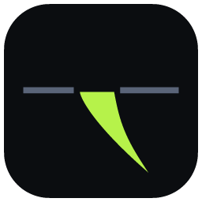

# Keel

> A Windows 11 PC optimizer with an undo button for everything.



**Status: packaged, not yet signed.** An installable Windows app — `Keel.exe`
(one file, ~12 MB) plus a per-user installer that needs no administrator rights.
Under it: sixteen feature screens collapsed into **four tabs**, a journal that
undoes every change, and a local console with 437 tests (the Windows-only ones
run in CI). No cloud, no account, no telemetry, no network connection at all.

**Why "Keel"?** The fin under a hull you never see from the deck, and the only
reason the boat does not capsize. That is where the work is here: the switches
are small, the journal and the watchdog are the product. See
[`IDENTITY.md`](IDENTITY.md).

## Build the installer

```powershell
.\packaging\build.ps1          # Keel.exe + Keel-0.5.0-Setup.exe, then smoke-tests the exe
```

PyInstaller cannot cross-compile — a Linux build produces a Linux binary with a
`.exe` name — so this runs on Windows. The CI `package` job builds both artefacts
on every push and attaches them to the run.

```bash
cd engine
python3 -m venv .venv && .venv/bin/pip install -q pytest
.venv/bin/python -m pco_engine.server      # console at http://localhost:7788
```

The console is a reference client for the same JSON the WinUI shell will consume: everything it shows comes from the real engine, and every change it makes is journaled, snapshotted and undoable in one click.

## Read in this order

| Doc | What it answers |
|---|---|
| [`IDEAS.md`](IDEAS.md) | The vision. Product thesis, the ideas catalogue, what ships first, and the moonshots |
| [`ARCHITECTURE.md`](ARCHITECTURE.md) | Stack (Rust engine + WinUI 3 shell), the motion contract, safety layers, sandboxing options, privacy, process model |
| [`FEATURES.md`](FEATURES.md) | Deep feature specs: Cleaner, Gaming session, DNS blocker, Startup surgeon, Installer Autopsy, palette, profiles, sandbox, file manager |
| [`SAFETY.md`](SAFETY.md) | Full access without breakage: guardrails, preflight, journal, golden snapshots, boot guard, panic key, failure scenarios, recovery playbook |
| [`MOTION.md`](MOTION.md) | The frame contract, tokens, motion language, screen-by-screen choreography, accessibility, measurement |
| [`IDENTITY.md`](IDENTITY.md) | Two moods (Casual / Pro), Nim the mascot, copy voice, naming |
| [`DESKTOP.md`](DESKTOP.md) | The customization suite: terminal, taskbar/shell theming, icon packs, wallpaper engine, widget layer, one-file themes |
| [`SENSITIVITY.md`](SENSITIVITY.md) | Sensitivity Lab: yaw math, the U-curve test, 360° capture, watch mode, per-game conversion |
| [`MASTERPLAN.md`](MASTERPLAN.md) | **The audit:** what's designed, the honest gaps, ~40 new features scored, how every existing module upgrades, and the next ten in order |
| [`SCHEMA.md`](SCHEMA.md) | **The full data model:** 67 validated SQLite tables, every document format, retention, migrations, privacy guarantees |
| [`ROADMAP.md`](ROADMAP.md) | **Honest build estimates:** solo vs team, the MVP cut, what "best UI/UX" actually costs, and risk buffers |

## Running code

| Path | What it is |
|---|---|
| [`WINDOWS.md`](WINDOWS.md) | **how to run it on your actual PC** — the four steps from simulated to real, with the expected output at each one |
| [`engine/`](engine) | **The app + the Guardian engine** — safety core (journal, preflight, snapshots, recovery, drift), checkup, cleaner with restorable vault, benchmark, ad/tracker blocker, recipes, event feed, Sens Lab, and the stdlib HTTP bridge + dark console. Python reference (400 passing tests), written to be ported to Rust 1:1 |

```bash
cd engine && python3 -m venv .venv && .venv/bin/pip install -q pytest
.venv/bin/python -m pco_engine.server                # the console, port 7788
.venv/bin/python -m pco_engine.cli --fresh crash     # the promise, demonstrated
.venv/bin/python -m pytest tests -q                  # 400 passed
```

The console covers sixteen feature screens under **four tabs** — Home (health ring,
live event feed, journal verification), Look (Desktop Lab, Studio themes,
Workspaces, Recipes), Speed (Checkup, Cleaner, Storage, Startup, Blocking,
Performance, Gaming) and Fix (Drivers, Battery & Heat, Hardware Lab, Autopsy,
Sens Lab). The full list: Checkup (per-category scores, consent tiers, fix-all with Undo),
Cleaner (scan → vault → restore), Storage (growth, forecast, hash-confirmed
duplicates), Startup (what boots, what to defer, what is refused), Hardware Lab
(five peripheral tests + the printable Health Report), Blocking
(on/off/pause/allow), Sens Lab (cm/360 ⇄ 14 games + the PSA test), Gaming (watch
gameplay → bottleneck → settings), Autopsy (install receipt → erase), Studio
(themes under a 3% idle-GPU budget), Performance (benchmark, weekly report),
Battery & Heat (health from design capacity, attributed drain, real throttle
events, boot guard, panic), Workspaces (capture what is open, preview-first
restore), Drivers (graded only by this machine's crashes) and Recipes (one
sentence → a preview you have to save) and Desktop Lab (taskbar, Explorer, icon
and theme customization — the 16 things Windows 11 allows, and the 5 it
refuses, each with the reason). Display control exists and is guarded by a
12-second watchdog that restores the previous mode unless you confirm — but it is
**off by default**, because a wrong mode can black the screen that would undo it.
The command palette shows the provider's mark
— GitHub, GitLab, Vercel, npm, PyPI — only when a remote, a token or a CLI
actually names that provider.

Plus a **command palette** (`Ctrl/⌘ K`) with engine-native verbs, and an **Ask**
box that answers "what did I change?" and "why is my disk full?" from the journal.

`engine/README.md` documents the guarantees each test proves and the Rust port
contract.

## Clickable concepts

Open in any browser — every control is wired:

- **[`concept.html`](concept.html)** — the dashboard with four sections (Overview · Gaming · Desktop studio · Safety): PC Checkup with one-button fixes, Nim, power modes, cleaner receipts, DNS blocker with master switch, palette, gaming coach + session, terminal, wallpaper engine, widgets, themes, Guardian journal, sandbox, privacy, motion lab
- **[`concept-sensitivity.html`](concept-sensitivity.html)** — **Sensitivity Lab**: a real playable aim drill that measures your optimum and converts it to 20+ games (yaw math included)
- **[`concept-sandbox.html`](concept-sandbox.html)** — **Installer Autopsy**: watch an installer, read the receipt, then keep or erase every trace. Includes the **Casual ↔ Pro** mood switch

## The one-line promise

Full access, but **you will never be stuck** — every action is measured, journaled, and one click from undone.

## In plain language

- [`GUIDE.md`](GUIDE.md) — **start here.** The whole design and every future feature explained simply, no jargon
